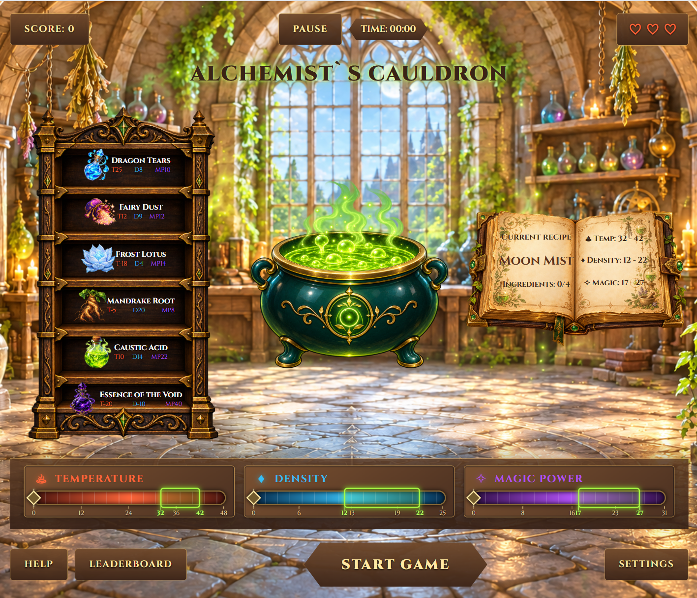

1. Task: https://github.com/rolling-scopes-school/qualifying-stage/blob/main/tasks/game-alchemists-cauldron/README.md

2. Screenshot:  
   

3. Deployment: https://viktoria12007.github.io/game-alchemists-cauldron/

4. Done: 25.10.2026 / Deadline: 26.10.2026

5. Score: 278 / 393

### Repository Setup — 25/25

- [x] Create the game repository, README and .gitignore — 10/10
- [x] Set up a clear and organized folder structure for the game — 10/10
- [x] Create a pull request template with a clear structure — 5/5

### Development Environment Configuration — 33/33

- [x] Set up and configure the bundler for development and production builds — 10/10
- [x] Configure TypeScript for strong typing — 5/5
- [x] Set up ESLint for consistent code quality checks — 5/5
- [x] Configure Prettier for automatic formatting — 5/5
- [x] Initialize Husky for commit and push hooks — 8/8

### level 1 - 170/170

- [x] Ingredient Shelf & Cauldron — 35/35
- [x] Cauldron Parameter Bars - 25/25
- [x] Recipe & Brewing Check - 45/45
- [x] Timer & Game Over - 30/30
- [x] Pause - 15/15
- [x] Leaderboard (Top-10) - 20/20

### level 2 - 50/50

- [x] Difficulty Selection — 25/25
- [x] Auto-save & Continue Game - 25/25
